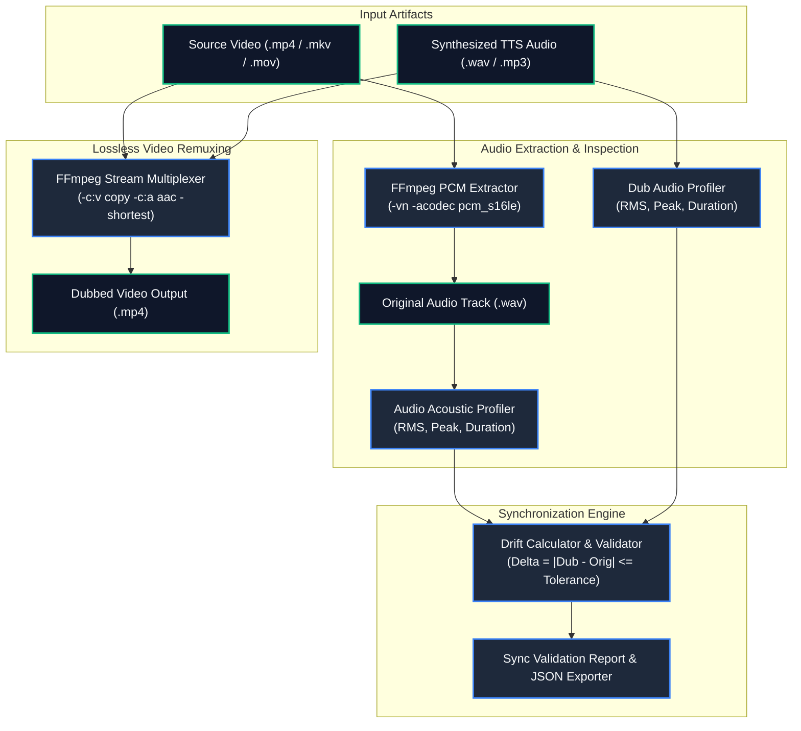

# 🎬 tts-smart-dubber

> **Topics:** `video-dubbing` `text-to-speech` `tts` `voiceover` `audio-sync` `ffmpeg` `video-localization`


[](https://github.com/MobileConduit/tts-smart-dubber/releases/tag/v1.0.0)
[](LICENSE)
[](https://github.com/MobileConduit/tts-smart-dubber/actions/workflows/ci.yml)
[](https://ffmpeg.org)
[](https://python.org)
[](https://docs.pytest.org)

An enterprise-grade video dubbing and audio replacement pipeline designed to seamlessly integrate AI-generated speech (Edge-TTS, ElevenLabs, XTTS, Coqui) with existing video assets. Preserves pristine original video bitstreams with zero generation loss (`-c:v copy`) while re-encoding and remuxing replacement audio, validating acoustic sync, and exporting comprehensive metrics.

---

## 🏗️ Architecture & Pipeline Flow

The following Mermaid diagram outlines the end-to-end audio extraction, synchronization verification, and lossless video remuxing pipeline:



---

## ✨ Features

- **Zero-Loss Video Remuxing:** Retains 100% of original visual quality using FFmpeg stream copy (`-c:v copy`).
- **Automated Synchronization Checks:** Compares original voice track duration against synthesized TTS track to flag potential lip-sync drifts.
- **Verbose Acoustic Metrics Export:** Probes frame counts, sample rates, channels, RMS energy, and peak amplitudes into structured JSON.
- **Environment Configuration:** Full support for `.env` files to configure codecs, bitrates, temp folders, and tolerances.
- **Automated Testing & CI/CD:** Comprehensive Pytest test suite with multi-version GitHub Actions CI pipeline.

---

## 🚀 Installation & Setup

### Prerequisites
- Python 3.10 or higher
- System FFmpeg installed and accessible via system PATH

```bash
# Clone the repository
git clone https://github.com/MobileConduit/tts-smart-dubber.git
cd tts-smart-dubber

# Install dependencies
pip install -r requirements.txt
```

### Environment Configuration
Copy the example environment file:
```bash
cp .env.example .env
```

| Variable | Default | Description |
| :--- | :--- | :--- |
| `FFMPEG_BINARY` | `ffmpeg` | Path or name of FFmpeg executable |
| `DUBBER_AUDIO_CODEC` | `aac` | Target audio codec for remuxing |
| `DUBBER_AUDIO_BITRATE` | `192k` | Output audio bitrate |
| `DUBBER_TEMP_DIR` | `_dub_temp` | Temporary directory for intermediate tracks |
| `SYNC_TOLERANCE_SECONDS` | `1.5` | Allowed duration drift before warning |

---

## 💻 CLI Usage

### Basic Dubbing
```bash
python dubber.py --video input.mp4 --audio arabic_voiceover.wav --output dubbed_video.mp4
```

### Synchronized Dubbing with Verbose Metrics Export
```bash
python dubber.py \
  --video documentary.mp4 \
  --audio synthesized_speech.wav \
  --output documentary_dubbed.mp4 \
  --codec aac \
  --bitrate 256k \
  --validate-sync \
  --sync-tolerance 1.0 \
  --export-metrics sync_metrics.json
```

---

## 🧪 Testing

Execute the automated test suite locally:
```bash
pytest -v tests/
```

---

## 👤 Author & Maintainer

**Eng. MHD. Shadi AL-Hasan**  
- **Role:** Executive CTO & Enterprise Solutions Architect  
- **Email:** [mhd.shadi.alhasan@gmail.com](mailto:mhd.shadi.alhasan@gmail.com)  
- **Phone / WhatsApp:** [+963934005922](tel:+963934005922)  
- **Location:** Damascus, Syria  
- **GitHub:** [MobileConduit](https://github.com/MobileConduit)  

---

## 📄 License

This project is licensed under the MIT License - see the [LICENSE](LICENSE) file for details.  
Copyright (c) 2026 **MHD. Shadi AL-Hasan**. All rights reserved.